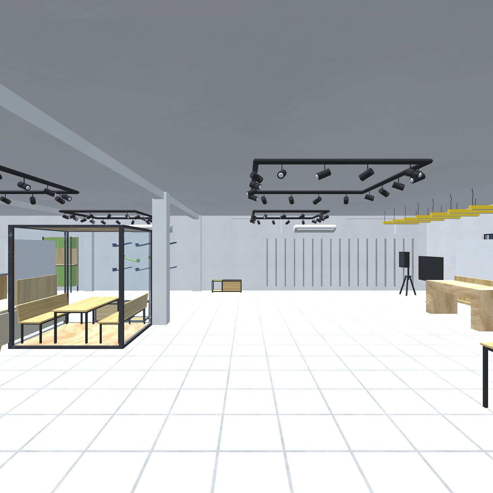

# Missão Estágio — Sebrae Lab VR

Experiência em realidade virtual em que o visitante conhece o Sebrae Lab no papel de um estagiário em seu primeiro dia: explora o espaço, conversa com o gestor e recebe pequenas missões.

A cena de entrega inclui o expediente completo e a sala de descompressão. A versão usada no projeto é 6000.0.83f1. O roteiro acadêmico cita 6.3 LTS. A equipe precisa confirmar com a disciplina se a versão usada é aceita. O teste no headset permanece pendente.

## Comece por aqui

1. Instale **Unity 6000.0.83f1** pelo Unity Hub.
2. Clone o repositório:

~~~bash
git clone https://github.com/diegovitor90/sebrae_unity.git
cd sebrae_unity
~~~

3. No Unity Hub, adicione a pasta que contém **Assets, Packages e ProjectSettings**. Aguarde a importação e a compilação.
4. No menu superior do editor, abra **Sebrae Lab → Missao 01 → 2 - Abrir missao do gerente**.
5. Para teclado e mouse, pare o Play, ative **Sebrae Lab → 4 - Alternar simulador PC** e clique em **▶ Play**.

Se o simulador já estiver ativo, basta iniciar o Play. O menu **Sebrae Lab** fica na barra superior, junto de File, Edit e Window. Ele não é a pasta da janela Project.

[Instalação e primeiros testes](docs/COMECE_AQUI.md) · [Índice da documentação](docs/README.md)

## Percurso e entrega

Abra a cena SebraeLab_MissaoGerente. O visitante conversa com o gerente, abre a porta pela maçaneta e entra na ala de atividades. Confirma a leitura do mural, pega o café e organiza dois livros, duas cadeiras e dois notebooks. Na mesa de inovação pode examinar a cartilha e o protótipo. Depois do sexto item, a sala de descompressão oferece boliche e um jogo de arco arcade com pontuação.

Para gerar a versão Android, saia do Play e selecione **Sebrae Lab → Entrega → Gerar APK do expediente completo**. O editor grava **Builds/Quest/MissaoEstagio.apk**. A simulação no editor e a instalação em um headset são etapas distintas de validação.
## Organização

~~~text
Assets/
├── SebraeLab/       # Cenas, scripts, materiais, ambiente e missão
├── Sebraelab3D/     # 27 modelos FBX e quatro texturas originais
├── Samples/         # Exemplos do XR Interaction Toolkit
├── XR/              # Configurações OpenXR
└── XRI/             # Configurações de interação
Packages/            # Dependências e versões fixadas
ProjectSettings/     # Configurações e versão do Unity
Previews/            # Imagens do ambiente para revisão
docs/                # Guias, status e testes
.github/             # Modelos de issue e pull request
Archives/SebraeLabUnityAssets.unitypackage  # Pacote original preservado
~~~

[Arquitetura, prefabs, modelos e colisões](docs/ESTRUTURA.md). Caches, logs, preferências locais, ferramentas Android e builds ficam fora do Git.

## Base técnica

- **Unity 6000.0.83f1**, com alvo Meta Quest 3/3S.
- **XR Interaction Toolkit 3.0.11**, **OpenXR 1.16.1** e **Input System 1.19.0**.
- Android **ARM64 / IL2CPP**, Vulkan, API mínima **32** e alvo **35**.
- Texturas Android ASTC 6×6 com mipmaps; atlas até 2048 e demais texturas até 1024.

As dependências são controladas por [manifest.json](Packages/manifest.json) e [packages-lock.json](Packages/packages-lock.json). As ferramentas Android devem ser configuradas em cada computador.

## Documentação e equipe

- [Abrir e testar o projeto](docs/COMECE_AQUI.md)
- [Verificações realizadas e roteiro de testes](docs/TESTES.md)
- [Detalhes da primeira missão](docs/MISSAO_GERENTE.md)
- [Roadmap e próximas entregas](docs/ROADMAP.md)
- [Como contribuir](CONTRIBUTING.md)
- [Aprender Git e GitHub](docs/VERSIONAMENTO.md)
- [Papéis propostos para a equipe](docs/EQUIPE.md)

Use as [Issues](https://github.com/diegovitor90/sebrae_unity/issues) para registrar falhas e tarefas. Informe sempre a cena e se o resultado foi verificado no editor ou no Quest.
