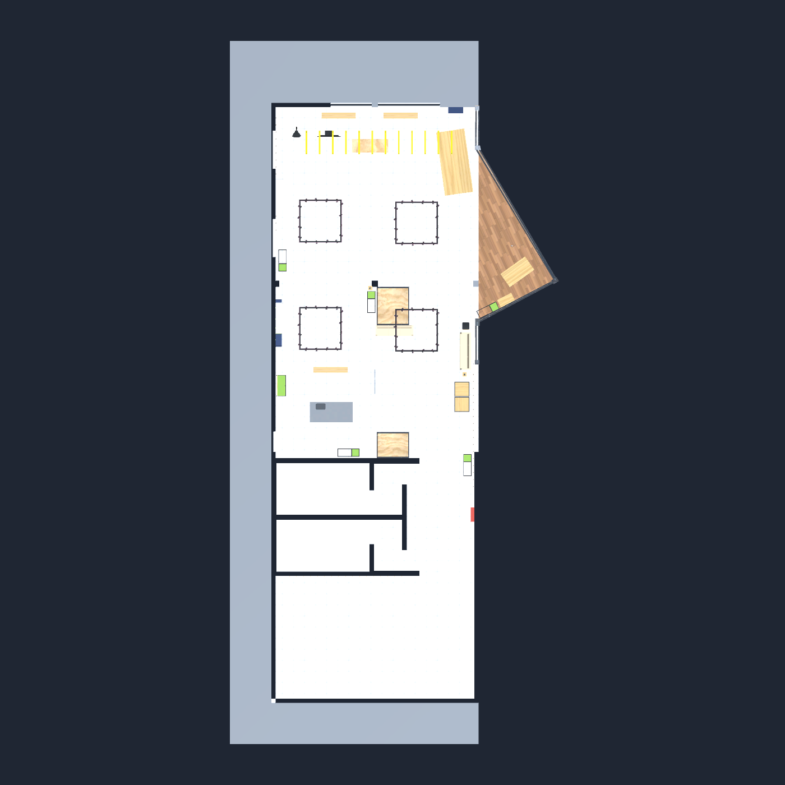

# Estrutura e arquitetura

## Project e Hierarchy

**Project** mostra os arquivos disponíveis. **Hierarchy** mostra os objetos usados na cena aberta.

Um FBX é um modelo; a cena registra onde ele aparece e os componentes ligados a ele. Um **prefab** é um conjunto reutilizável de objetos e componentes. Várias cadeiras podem usar o mesmo modelo sem duplicar o arquivo de origem.

| Caminho | Responsabilidade |
| --- | --- |
| Assets/Sebraelab3D/ | Modelos e quatro texturas originais |
| Assets/SebraeLab/Scenes/ | Testes, exploração e missão |
| Assets/SebraeLab/Environment/ | Materiais, malhas de colisão e prefab do ambiente |
| Assets/SebraeLab/Missions/Manager/ | Materiais e prefab visual do gerente |
| Assets/SebraeLab/Scripts/Missions/ | Lógica de execução da missão |
| Assets/SebraeLab/Scripts/VRTestButton.cs | Botão da sala de testes |
| Assets/SebraeLab/Editor/Setup/ | Montagem do ambiente, configuração VR e build |
| Assets/SebraeLab/Editor/Validation/ | Verificações das missões e do percurso |
| Assets/SebraeLab/Editor/Tours/ | Demonstração das cinco missões |
| Assets/SebraeLab/Art/Textures/Acabamentos/ | Imagens das superfícies dos objetos |
| Assets/SebraeLab/Resources/Acabamentos/ | Materiais carregados pelas missões |
| Assets/Samples/ | Recursos dos exemplos oficiais usados no jogador e no simulador |
| Assets/XR/ e Assets/XRI/ | OpenXR e configurações de interação |
| Packages/ | Dependências e lockfile |
| ProjectSettings/ | Configurações compartilhadas |
| Previews/ | Renderizações para revisar a montagem |

O pacote .unitypackage em Archives/ preserva o material recebido. Não é preciso importá-lo novamente para abrir este projeto completo.

## Ambiente

~~~text
SebraeLab_Exploracao — cena
├── SebraeLab - Ambiente
│   ├── 01 - Arquitetura
│   ├── 02 - Mobiliario
│   ├── 03 - Decoracao e luminarias
│   └── 04 - Colisoes e navegacao
├── Iluminacao
├── Jogador VR - Recepcao
├── XR Interaction Manager
└── Simulador PC - excluido da build
~~~

A montagem usa a exportação com objetos separados. Foram retirados da cena 24 elementos auxiliares/de catálogo; os arquivos de origem foram preservados. Sobrepor a versão combinada à montagem duplicaria a geometria.

A escala original foi mantida, aproximadamente um metro por unidade Unity; a geladeira mede cerca de 1,72 m. O conjunto foi centralizado em X.

Foram aplicados materiais de paredes, azulejo, madeira, metal, vidro e atlas trim sheet. A iluminação usa ambiente e luz direcional sem sombras em tempo real. Não houve medição de desempenho no Quest registrada.

## Colisões

A base foi separada em estrutura e piso navegável. O piso de teletransporte contém 178 triângulos horizontais voltados para cima, na altura zero, e usa a camada **31 — Teleport**.

Paredes, portas e móveis usam colisões de malha estática. A locomoção configurada é teletransporte com giro de 45°. Essas colisões não tornam os objetos manipuláveis.

Ao tornar um móvel dinâmico, revise Rigidbody, tipo de collider e interação. Prefira prefabs próprios para os objetos das futuras missões.

## Missão do gerente

| Script | Responsabilidade |
| --- | --- |
| ManagerMission.cs | Estados, diálogo, proximidade/linha de visão, interface, aceite, conclusão e reinício |
| MissionRoomZone.cs | Verificação da cabeça do jogador dentro da sala |
| ManagerNpcInteraction.cs | Seleção do NPC pelo XRI |
| ManagerMissionSetup.cs | Montagem do NPC, painéis, rota, cena e comando de build |
| ManagerMissionCheck.cs | Verificação do fluxo em Play Mode |

~~~text
Buscar gerente → Conversar → Aceitar → Encontrar sala → Concluir
      ↑                                                 │
      └──────────────── Reiniciar ──────────────────────┘
~~~

A conversa exige até 2,2 m de distância e linha de visão livre. A conclusão usa a cabeça do jogador, evitando concluir só por colocar um controle no destino.

## Novas entregas

- Comportamentos de jogo em Scripts; ferramentas que dependem de UnityEditor em Editor.
- Assets de cada missão em uma pasta própria.
- Preserve .meta e mova/renomeie arquivos pela janela Project.
- Diferencie modelo estático, objeto manipulável e ponto de entrega.
- Atualize os testes e a documentação quando o comportamento mudar.
